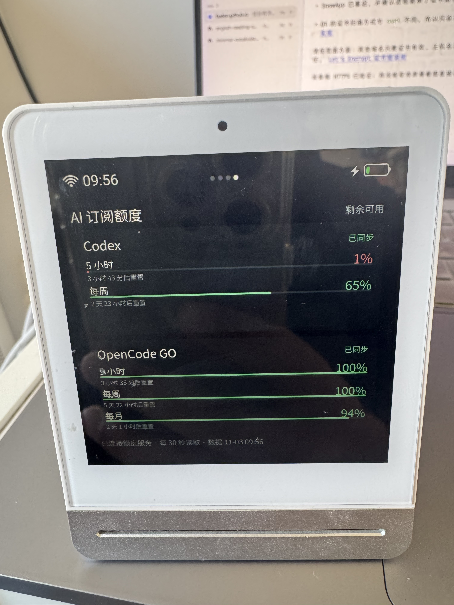

# 青萍 AI 订阅额度屏：使用指引

这个项目在青萍 CGS1 上展示 AI 订阅额度。当前采集器支持 **Codex** 和 **OpenCode GO**：Mac 负责读取额度并保管授权信息，青萍读取 JSON 并显示。

<p align="center"></p>

## 运行方式

额度服务始终在 Mac 上提供局域网 HTTP 接口。可选开启 VPS 发布，让 Mac 定时把同一份 JSON 上传到网站静态目录。

| 方式 | 青萍访问地址 | Mac 离线时 |
| --- | --- | --- |
| Mac 局域网 | `http://Mac局域网IP:8766/api/v1/quotas` | 设备无法获取新数据 |
| VPS 静态文件 | `https://example.com/quota.json` | 网站仍提供最后一次上传的数据，之后会变旧 |

两种方式可以并用。`publish.enabled` 决定是否额外上传到 VPS；安装设备页面时指定的 URL 决定设备读取哪边。VPS 只托管静态 JSON，不替代 Mac 进行额度采集。

## 支持的订阅与授权

### Codex

服务通过 Codex CLI 的 `app-server` 查询当前登录账户额度，不直接读取某个固定的 Codex 授权文件。先在 Mac 上安装并登录 Codex CLI。CLI 的数据目录默认是 `~/.codex`；可以用 `codex_home` 指定其他绝对路径或 `~/...` 路径。Codex CLI 负责在该目录中读取自己的登录状态，也可能使用系统凭据存储。更多信息见 [Codex CLI 的 CODEX_HOME 说明](https://github.com/openai/codex/blob/main/codex-rs/core/src/config/mod.rs)。

`codex_bin` 用于指定 Codex CLI 可执行文件的位置；默认是 `~/.local/bin/codex`。如果实际安装位置不同，可填写完整路径。

### OpenCode GO

服务读取 Pi 的认证 JSON 文件中的 `opencode-go` API key，再查询 OpenCode GO usage 接口。默认文件路径为 `~/.pi/agent/auth.json`，由 `pi_auth_file` 配置。文件至少需要有如下结构：

```json
{
  "opencode-go": {
    "type": "api_key",
    "key": "<你的 OpenCode GO API Key>"
  }
}
```

如果认证文件不在默认位置，可将 `pi_auth_file` 改成以 `~/` 开头的路径或绝对路径。不要把 key 粘贴到 `config.json`，也不要提交认证文件。

## `config.json` 配置说明

首次设置时复制示例文件，然后按需编辑：

```sh
cd ~/Code/qingping-cgs1-ai-quota-display
cp config.example.json config.json  # 仅首次执行；已有配置不要覆盖
```

| 字段 | 含义 | 默认值 / 示例 |
| --- | --- | --- |
| `host` | Mac HTTP 服务监听地址；`0.0.0.0` 供局域网设备访问，`127.0.0.1` 仅本机访问 | `0.0.0.0` |
| `port` | 本机 HTTP 服务端口 | `8766` |
| `poll_seconds` | Mac 查询额度的间隔 | `60` 秒 |
| `stale_after_seconds` | 来源数据多长时间未更新后标为过期；必须至少是 `poll_seconds` 的两倍 | `180` 秒 |
| `device_refresh_seconds` | 青萍页面读取 JSON 的间隔；改后需重新安装页面 | `300` 秒 |
| `codex_bin` | Codex CLI 可执行文件路径 | `~/.local/bin/codex` |
| `codex_home` | Codex CLI 数据目录；留空表示使用 CLI 默认目录 | `""`（即 `~/.codex`） |
| `pi_auth_file` | 含 OpenCode GO 授权信息的 Pi JSON 文件路径 | `~/.pi/agent/auth.json` |
| `cache_file` | Mac 本地额度缓存文件；相对路径以项目目录为基准 | `runtime/quotas.json` |
| `publish.enabled` | 是否向 VPS 发布静态 JSON | `false` |
| `publish.ssh_host` | `~/.ssh/config` 中的 SSH 主机别名 | `my-vps`（示例） |
| `publish.remote_path` | VPS 上可写的 JSON 文件绝对路径 | `/var/www/example.com/quota.json`（示例） |
| `publish.interval_seconds` | 向 VPS 上传的间隔 | `60` 秒 |
| `publish.timeout_seconds` | 单次 SSH 发布超时 | `20` 秒 |

`codex_home`、`codex_bin`、`pi_auth_file` 支持 `~` 展开；推荐使用绝对路径或 `~/...`。`cache_file` 可用绝对路径，也可用相对于项目目录的路径。修改后端采集、缓存或 VPS 配置后，重启后台服务使其生效。

`config.example.json` 中的 SSH 主机名、远端路径和域名都是占位示例。使用 VPS 时，替换成你自己的 SSH 别名、网站目录和 HTTPS JSON 地址；README 不记录个人 VPS 参数。

## 首次启动 Mac 服务

先确认两种额度都能读取：

```sh
python3 -m service.main --config config.json --check
```

本机预览地址为 <http://127.0.0.1:8766/>，健康状态接口为 `/healthz`。然后安装并启动用户级 LaunchAgent：

```sh
python3 scripts/launch_agent.py install
python3 scripts/launch_agent.py status
```

常用管理命令：

```sh
python3 scripts/launch_agent.py stop
python3 scripts/launch_agent.py start
python3 scripts/launch_agent.py uninstall
```

登录 macOS 后服务会自动启动。Mac 睡眠、关机或退出登录时不会采集或上传新数据。日志在 `runtime/service.log` 和 `runtime/launchd.stderr.log`。

## 选择并启用 VPS 发布（可选）

1. 在 `config.json` 中将 `publish.enabled` 设为 `true`。
2. 设置自己的 `publish.ssh_host`、`publish.remote_path`，并确认该别名可以免交互 SSH 登录、目标目录可写。
3. 用自己的 HTTPS 地址手动上传并确认文件可访问：

```sh
python3 -m service.main --config config.json --publish-once
curl -fsS https://example.com/quota.json
```

4. 持续发布时重启服务：

```sh
python3 scripts/launch_agent.py stop
python3 scripts/launch_agent.py start
```

## 安装页面到青萍

设备需已安装带外置 QML 页面入口的 SnowApp，开启 ADB 并通过 USB 连接。选择一种地址安装：

```sh
adb devices

# Mac 局域网：替换成 Mac 的实际局域网 IP
python3 scripts/device.py install --url http://192.168.1.20:8766/api/v1/quotas

# VPS：替换成自己的 HTTPS JSON 地址
python3 scripts/device.py install --url https://example.com/quota.json
```

如有多台设备，增加 `--serial 设备序列号`。安装脚本会核对已知 SnowApp 补丁版本，使用 `adb push` 上传并校验文件，再切换页面、重启 SnowApp。页面使用两个固定目录轮换，避免更新时不断增加存储占用；首次安装时会备份原有自定义页。

HTTPS 根证书也由安装脚本处理：仓库内的 `certs/ISRG-Root-X1.pem` 是公开的 ISRG Root X1，脚本会校验文件 SHA-256，不存在或不匹配时重新上传。设备的 `/` 是只读分区，证书存放在 `/data/custom/ai-quota-display/`，并绑定到 Qt 扫描的 `/etc/ssl/certs`。

看门狗所需的两行启动配置保存在 `scripts/watchdog-ca.sh`。安装时脚本只把这段配置插入设备原有的 `/data/bin/watchdog.sh`，不会用仓库文件替换整份设备脚本；修改前会在 `/data/custom/ai-quota-display/watchdog.sh.orig` 保存原文件并校验备份。看门狗在设备启动时重新挂载证书目录，因此 HTTPS 信任配置可跨重启保留。证书仍按正常 TLS 规则校验，不会忽略证书错误。

恢复到首次安装前的页面：

```sh
python3 scripts/device.py restore
```

## 调整刷新间隔

修改 `config.json` 中的 `device_refresh_seconds`，例如 `600` 表示每 10 分钟读取一次，然后用**当前正在使用的 URL**重新安装页面：

```sh
python3 scripts/device.py install --url https://example.com/quota.json
```

## 网络与隐私

- 局域网模式下，Mac 与青萍需要在互通的网络中。可用 `ipconfig getifaddr en0` 查看 Mac Wi-Fi 地址，也可在路由器中为 Mac 保留 DHCP 地址。
- 本机 HTTP 服务没有认证。不要将 8766 端口映射到公网；macOS 防火墙提示时，允许 Python 接受局域网连接。
- VPS 发布的 JSON 是公开文件，只包含展示所需的名称、额度、重置时间和状态。发布前确认这些额度信息适合公开。
- VPS 上的静态文件不会自行更新。Mac 离线或服务停止时，设备仍可能读到旧文件，页面会标记旧数据。
- 当前页面按 JSON 中的 `providers` 数组动态显示订阅卡片；但 Mac 端采集器目前只实现 Codex 和 OpenCode GO。新增实时来源还需实现相应采集逻辑，让服务生成新的 JSON 条目。

## 常见问题

- **页面连不上 Mac**：确认设备 URL 中的 IP 和端口正确，Mac 服务运行中，设备与 Mac 在互通网络，防火墙允许连接。
- **VPS 数据没更新**：确认 `publish.enabled`、SSH 别名、远端目录权限及 LaunchAgent 状态；发布状态见 `runtime/publish-status.json`。
- **授权失败**：检查 Codex CLI 是否已登录；检查 Pi 授权文件路径和 `opencode-go` 条目。运行 `python3 -m service.main --config config.json --check` 查看采集状态。不要分享密钥或授权文件。
